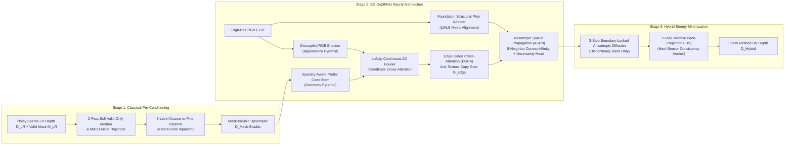

# Academic Viva Defense & Technical Preparation Guide
**Project Title**: Edge-Preserving Depth Map Upsampling and Refinement (`ProbID - P4`)  
**Core Architecture**: `EG-DepthNet` (Edge-Gated Cross-Guidance Network with Anisotropic Spatial Propagation & Hybrid Bilateral Mode Energy Minimization)  
**Team**: Genesis (`Team ID: T14`)  
**Repository**: `https://github.com/shlokbshetty/Depth-lab`

---

## 1. Conceptual Foundation to Advanced Architecture

### 1.1 Foundational Computer Vision & CNN Concepts in Depth Estimation

#### A. 2D Appearance Manifolds vs. 3D Metric Geometry Manifolds
In standard computer vision, an RGB image $I \in \mathbb{R}^{H \times W \times 3}$ records **radiometric appearance**—the product of surface reflectance (albedo), illumination, and camera response. Conversely, a depth map $D \in \mathbb{R}^{H \times W \times 1}$ encodes **metric 3D Euclidean geometry**—the orthogonal distance $Z(u, v)$ in meters from the camera's optical center to the physical scene surface along each pixel ray $(u, v)$.

Under the **Pinhole Camera Model** with intrinsic parameters $(f_x, f_y, c_x, c_y)$, every pixel $(u, v)$ with depth $Z = D(u, v)$ back-projects directly into 3D world coordinates $(X, Y, Z) \in \mathbb{R}^3$:
$$X = \frac{(u - c_x) \cdot Z}{f_x}, \qquad Y = \frac{(v - c_y) \cdot Z}{f_y}, \qquad Z = D(u, v)$$

> [!IMPORTANT]
> **Key Viva Takeaway**: Because $X$ and $Y$ are multiplied by $Z$, a small error in depth $D(u, v)$ at an object boundary does not merely discolor a 2D pixel—it physically displaces the point in 3D space along the viewing ray, destroying 3D point cloud topology and robotic obstacle avoidance.

#### B. Spatial Downsampling, Receptive Fields, and Hardware Sensor Bottlenecks
Why do low-resolution and sparse depth maps exist in the first place?
1. **Physics of Active Depth Sensors**: Time-of-Flight (ToF) cameras (e.g., Kinect v2, iPhone LiDAR), structured-light sensors (e.g., Kinect v1 in NYUv2, Intel RealSense), and rotating automotive LiDARs (e.g., Velodyne 64-beam in KITTI) operate under strict photon budget, power, and baseline constraints. As a result, hardware depth sensors capture at **$2\times, 4\times,$ or $8\times$ lower spatial resolution** than the paired megapixel RGB CMOS sensor, alongside **missing holes** (IR emitter-receiver parallax shadows, specular reflections, dark absorbing surfaces) and **axial sensor noise**.
2. **CNN Strided Downsampling & Receptive Field Trade-Off**: In Convolutional Neural Networks (CNNs), stacked convolutions with stride $s > 1$ or pooling layers expand the effective **receptive field** (allowing the network to understand global scene context and planar room layout) while reducing spatial feature dimensions from $(H, W) \to (H/s, W/s)$.
3. **Nyquist-Shannon Sampling Breakdown at Occlusions**: A 3D occlusion boundary (e.g., a foreground chair at $1.2\text{ m}$ in front of a background wall at $3.8\text{ m}$) is a mathematical **Heaviside step function** containing infinite spatial frequencies. When downsampled by $s \in \{2, 4, 8\}$, spatial frequencies above the Nyquist limit ($\omega_{\text{Nyquist}} = \frac{\pi}{s}$) alias irreversibly in the depth channel alone.

---

### 1.2 Why Naive Upsampling Destroys High-Frequency Edge Data

Standard spatial interpolation methods treat a depth map as a smooth, band-limited 2D signal and compute each high-resolution pixel $p$ as a fixed, content-agnostic linear combination of low-resolution neighbors $q \in \mathcal{N}(p)$:
$$D_{\text{naive}}(p) = \sum_{q \in \mathcal{N}(p)} w_{\text{spatial}}(\|p - q\|) \cdot D_{\text{LR}}(q)$$

| Naive Technique | Mathematical Kernel | Fatal Flaw on Depth Maps |
| :--- | :--- | :--- |
| **Nearest-Neighbor** | Piecewise-constant box filter ($1 \times 1$) | Produces severe **staircase / jagged block aliasing** ($s \times s$ pixel tiles) along diagonal silhouettes and quantizes continuous sloped surfaces into discrete terraces. |
| **Bilinear Interpolation** | Linear tent filter ($2 \times 2$ neighborhood) | Smooths monotonically across foreground ($Z_{\text{fg}}$) and background ($Z_{\text{bg}}$), turning sharp step edges into a linear ramp of width $s$ pixels. |
| **Bicubic Interpolation** | Cubic spline convolution ($4 \times 4$ neighborhood) | Introduces both **cross-boundary low-pass blurring** and **Gibbs ringing (overshoot/undershoot halos)** at high-contrast depth steps. |

#### The "Flying Pixel" Phenomenon in 3D Space
Suppose a foreground object at $Z_{\text{fg}} = 1.0\text{ m}$ occludes a wall at $Z_{\text{bg}} = 4.0\text{ m}$. No physical surface exists between $1.0\text{ m}$ and $4.0\text{ m}$. Yet at the boundary, bilinear/bicubic interpolation computes weighted averages:
$$D_{\text{interp}}(p) = \alpha Z_{\text{fg}} + (1 - \alpha) Z_{\text{bg}} \in (1.0\text{ m},\ 4.0\text{ m}) \quad \text{for } \alpha \in (0, 1)$$
When unprojected into 3D space via the pinhole model, these interpolated values form a synthetic curtain of **"flying pixels"** floating in mid-air between the foreground object and the background wall. Furthermore, if the low-resolution sensor has missing holes ($D_{\text{LR}}(q) = 0$), naive kernels average valid depths with $0.0\text{ m}$, dragging valid surfaces violently toward the camera lens.

---

### 1.3 Evolution of Edge-Preserving Frameworks & The Texture-Copying Paradox

To recover high-frequency boundaries lost during sensor downsampling, Guided Depth Super-Resolution (GDSR) introduces the paired high-resolution RGB image $I_{\text{HR}}$ as a structural structural guide, based on the **Co-Occurrence Prior**: *3D depth discontinuities almost always project to 2D intensity/color edges in the RGB image*.

However, the converse is **false**: *most 2D RGB edges (wallpaper patterns, floor tiles, printed text, cast shadows) correspond to completely flat 3D surfaces*.

1. **Classical Explicit Filtering (Joint Bilateral Filter & Guided Filter)**:
   - **Joint Bilateral Filter (JBF, Kopf et al.)**: Multiplies a spatial Gaussian kernel by a photometric range Gaussian over RGB differences:
     $$w_{\text{JBF}}(p, q) = \exp\left(-\frac{\|p - q\|^2}{2\sigma_s^2}\right) \exp\left(-\frac{\|I_{\text{HR}}(p) - I_{\text{HR}}(q)\|^2}{2\sigma_r^2}\right)$$
   - **Guided Filter (He et al.)**: Assumes depth is a local linear transformation of RGB intensity within window $\omega_k$: $D(p) = a_k I_{\text{HR}}(p) + b_k$.
   - **Why Classical Filters Fail**: Whenever a flat wall has high-contrast texture ($\|\nabla I_{\text{HR}}\| \gg 0$), the linear coefficient $a_k$ or bilateral range weight transfers the 2D RGB gradient directly into the 3D depth map—a defect known as **Texture-Copying**.
2. **Advanced Edge-Preserving Deep Frameworks**:
   - Modern deep frameworks (such as **EG-DepthNet**, inspired by *PatchRefiner ECCV 2024* and *LoftUp ICCV 2025*) replace hand-crafted photometric weights with **decoupled geometry/appearance feature pyramids**, **learned Edge-Coherence Gates ($G_{\text{edge}} \in [0, 1]$)** that verify whether an RGB edge is backed by a true 3D geometric transition, **continuous coordinate cross-attention**, and **anisotropic spatial affinity propagation**.

---

### 1.4 Deep Breakdown of the `EG-DepthNet` & Hybrid Pipeline

Our system implements a **3-Stage Self-Distilled Hybrid Architecture** ([eg_depth_net.py](file:///C:/GitHub/Depth-Lab/src/depth_refine/models/eg_depth_net.py) and [hybrid_pipeline.py](file:///C:/GitHub/Depth-Lab/src/depth_refine/hybrid/hybrid_pipeline.py)):

#### Stage 1: Classical Pre-Conditioning & Mask-Bicubic Initialization
1. **2-Pass Valid-Only Order-Statistic Median + MAD Outlier Filter** ([hole_filling.py](file:///C:/GitHub/Depth-Lab/src/depth_refine/classical/hole_filling.py)):
   - Computes the local median $m(p)$ and Median Absolute Deviation $\text{MAD}(p) = \text{median}(|D - m(p)|)$ strictly over valid non-zero pixels in a $5 \times 5$ window.
   - Rejects multipath ToF/stereo spikes where $|D(p) - m(p)| > \max(3 \cdot 1.4826 \cdot \text{MAD}(p),\ \tau_{\text{rel}} m(p))$.
2. **5-Level Multi-Scale Pyramid Hole Filling**:
   - Constructs a 5-level valid-masked dyadic pyramid ($\{1/16, 1/8, 1/4, 1/2, 1\}$), bridging arbitrarily wide structured occlusion shadows from coarse to fine using harmonic Laplace smoothing and RGB cross-bilateral refinement.
3. **Stage-1 Mask-Bicubic Upsampler** ([filters.py](file:///C:/GitHub/Depth-Lab/src/depth_refine/classical/filters.py)):
   - Partitions local windows into foreground/background modes $M(p)$ and weights bicubic coefficients by both partition agreement and RGB edge-stopping weights:
     $$D_{\text{Mask-Bicubic}}(p) = \frac{\sum_{q \in \mathcal{N}(p)} w_{\text{bicubic}}(p,q) \cdot \mathbb{I}(M(p) == M(q)) \cdot w_{\text{edge}}(I_p, I_q) \cdot D_{\text{LR}}(q)}{\sum_{q \in \mathcal{N}(p)} w_{\text{bicubic}}(p,q) \cdot \mathbb{I}(M(p) == M(q)) \cdot w_{\text{edge}}(I_p, I_q)}$$

#### Stage 2: `EG-DepthNet` Core Modules ([eg_depth_net.py](file:///C:/GitHub/Depth-Lab/src/depth_refine/models/eg_depth_net.py))
1. **Sparsity-Aware Partial Convolution Stem (`PartialConv2d`)**:
   - Normalizes every $3 \times 3$ convolution strictly by the ratio of valid sensor pixels in the receptive window:
     $$\mathbf{f}'(p) = \mathbf{W}^\top (\mathbf{f}(p) \odot \mathbf{m}(p)) \cdot \frac{\|\mathbf{1}\|_1}{\max(\|\mathbf{m}(p)\|_1, \epsilon)} + \mathbf{b}$$
   - Ensures missing sensor pockets never contaminate feature activations with zero-padding bias.
2. **Foundation Structural Prior Adapter (`FoundationStructuralPriorAdapter` — PatchRefiner-Inspired)**:
   - Extracts a dense, hole-free relative structural prior $P_{\text{rel}} \in [0, 1]$ from high-resolution RGB guidance (preserving thin chair legs, cables, and foliage).
   - Aligns $P_{\text{rel}}$ locally to the physical metric scale of the low-resolution sensor via ridge-regularized **Locally Weighted Least-Squares (LWLS)** over patch windows:
     $$D_{\text{prior}}(p) = a(p) \cdot P_{\text{rel}}(p) + b(p), \qquad a(p) = \frac{\text{Cov}_w(P_{\text{rel}}, D_{\text{LR}})}{\text{Var}_w(P_{\text{rel}}) + \lambda_{\text{ridge}}}$$
3. **Continuous 2D Fourier Coordinate Cross-Attention Upsampler (`ContinuousCoordCrossAttentionUpsampler` — LoftUp-Inspired)**:
   - Concatenates 8-channel 2D sinusoidal positional encodings $[\sin(\pi x), \cos(\pi x), \sin(\pi y), \cos(\pi y), \sin(2\pi x), \dots]$ with HR RGB feature queries $\mathbf{q}_p$, attending over unfolded $3 \times 3$ local depth feature neighborhoods $(\mathbf{K}_{\mathcal{N}(p)}, \mathbf{V}_{\mathcal{N}(p)})$:
     $$\mathbf{F}_{\text{up}}(p) = \mathbf{F}_{\text{LR}\uparrow}(p) + \tanh(\gamma) \cdot \mathbf{W}_{\text{out}} \sum_{j=1}^{9} \text{softmax}_j\left(\frac{\mathbf{q}_p^\top \mathbf{k}_{p,j}}{\sqrt{C}}\right) \mathbf{v}_{p,j}$$
   - Enables a single unified network to handle $2\times, 4\times,$ and $8\times$ upsampling without transposed-convolution checkerboard artifacts.
4. **Edge-Gated Cross-Attention (`EGCA`) & Anti-Texture-Copy Coherence Gate ($G_{\text{edge}}$)**:
   - Predicts a per-pixel gate $G_{\text{edge}}(p) \in [0, 1]$ conditioned jointly on geometric depth gradient energy and RGB gradient features:
     $$G_{\text{edge}}(p) = \sigma\Big(\text{MLP}_{\text{gate}}\big([\mathbf{F}_{\text{depth}}(p),\ \|\nabla D(p)\|,\ \mathbf{F}_{\text{RGB}}(p),\ \|\nabla I_{\text{HR}}(p)\|]\big)\Big)$$
     $$\mathbf{F}_{\text{fused}}(p) = \mathbf{F}_{\text{depth}}(p) + G_{\text{edge}}(p) \odot \text{CrossAttn}(\mathbf{F}_{\text{depth}}(p), \mathbf{F}_{\text{RGB}}(p))$$
   - On flat textured walls ($\|\nabla D\| \approx 0, \|\nabla I_{\text{HR}}\| \gg 0$), $G_{\text{edge}}(p) \to 0$, blocking RGB texture from corrupting the depth features. At true 3D occlusions, $G_{\text{edge}}(p) \to 1$, unlocking sub-pixel RGB boundary guidance.
5. **Anisotropic Spatial Propagation Network (`ASPN`) & Aleatoric Uncertainty Head ($\hat{\sigma}_D$)**:
   - Predicts non-negative 8-neighbor affinity weights $w_{p \to q} \ge 0$ normalized via softmax ($\sum_{q \in \mathcal{N}_8(p)} w_{p \to q} = 1$) and iteratively updates depth over $K = 4$ recurrent steps:
     $$D^{(t+1)}(p) = (1 - \alpha_p) D^{(t)}(p) + \alpha_p \sum_{q \in \mathcal{N}_8(p)} w_{p \to q} D^{(t)}(q)$$
   - Simultaneously outputs per-pixel **heteroscedastic aleatoric uncertainty** $\hat{\sigma}_D(p) = \text{Softplus}(\mathbf{W}_{\text{unc}} \mathbf{F}_{\text{fused}}(p)) + 10^{-3}$.

#### Stage 3: Hybrid Bilateral Mode Energy & Sensor Back-Projection ([hybrid_pipeline.py](file:///C:/GitHub/Depth-Lab/src/depth_refine/hybrid/hybrid_pipeline.py))
1. **Boundary-Locked Anisotropic Diffusion (BLAD)**:
   - Restricts 3-step shock/mode snapping strictly to the dilated discontinuity band $M_{\text{disc}}(p) \in [0, 1]$ where local min-max depth span exceeds $4.5\%$ of surface depth, snapping ambiguous edge pixels to either the foreground mode ($D_{\min}$) or background mode ($D_{\max}$) according to RGB photometric affinity.
2. **Iterative Back-Projection (IBP — Hard Sensor Consistency)**:
   - Enforces physical fidelity to the original valid low-resolution sensor measurements $D_{\text{LR}}$ on smooth interior surfaces:
     $$D^{(t+1)} = D^{(t)} + \lambda_{\text{IBP}} \cdot (1 - G_{\text{edge}}) \odot \mathcal{U}_{\uparrow s}\Big(\big(D_{\text{LR}} - \mathcal{P}_{\downarrow s}(D^{(t)})\big) \odot M_{\text{valid}}^{\text{LR}}\Big)$$

---

## 2. Model Comparisons & Baselines

### 2.1 Competing Paradigms & Evaluated Baselines
In our benchmark suite ([benchmark_runner.py](file:///C:/GitHub/Depth-Lab/src/depth_refine/evaluate/benchmark_runner.py)), we evaluate **10 methods** spanning 4 distinct computer vision families across $2\times, 4\times,$ and $8\times$ scaling factors:

1. **Un-Guided Spatial Interpolators**: `Nearest-Neighbour`, `Bilinear Interpolation`, `Bicubic Interpolation`.
2. **Classical RGB-Guided Edge-Aware Filters**:
   - `Guided Filter (He et al., TPAMI)` — Local linear variance/covariance transfer from RGB luminance.
   - `Joint Bilateral Filter (JBF, Kopf et al., SIGGRAPH)` — Spatial + photometric Gaussian kernel filtering.
   - `Mask-Bicubic (Stage 1)` — Valid-mask and bimodal foreground/background partitioned bicubic upsampler.
3. **Ungated Deep RGB-D Network**:
   - `Deep Model w/o Edge-Coherence Gate` (Ablation A5) — Standard concatenation of RGB and depth features without $G_{\text{edge}}$ gating.
4. **Our Proposed Deep & Hybrid Models**:
   - `EG-DepthNet (Deep BF16)` — End-to-end neural prediction with Partial Conv, LoftUp Coordinate Cross-Attention, PatchRefiner LWLS Prior, EGCA ($G_{\text{edge}}$), and ASPN.
   - `Self-Distilled Hybrid (Stage 2/3)` — `EG-DepthNet` coupled with Boundary-Locked Anisotropic Diffusion and Iterative Back-Projection.
   - `Hybrid INT8 Quantized (3.96× Compressed)` — Per-channel symmetric INT8 weight-quantized deployment model (`5.31 MB -> 1.34 MB`).

---

### 2.2 Shortcomings of Alternative Models vs. Our Approach

| Competing Approach | Core Technical Shortcomings | How `EG-DepthNet` + Hybrid Solves It |
| :--- | :--- | :--- |
| **Bilinear / Bicubic** | Isotropic low-pass averaging smears step discontinuities into linear ramps (**flying pixels**); Edge-F1 collapses to `0.0346` at $8\times$ on NYUv2. | **ASPN + Bilateral Mode Snapping** forces bimodal assignment at depth jumps, boosting NYUv2 $8\times$ Edge-F1 by **$9.1\times$** (`0.0346 -> 0.3157`). |
| **Guided Filter (He et al.)** | Assumes $\nabla D \propto \nabla I_{\text{HR}}$ everywhere. Suffers the worst **Texture-Copy Error** (`0.0362` at $4\times$, `0.0430` at $8\times$ on NYUv2) and actually *degrades* global RMSE vs. Bicubic (`0.2624 m` vs `0.2534 m` at $4\times$). | **Edge-Coherence Gate ($G_{\text{edge}}$)** and **Anti-Texture-Copy Smoothness Loss** suppress RGB injection on planar walls, cutting Texture-Copy Error by **$63.8\%$** (`0.0362 -> 0.0131` at $4\times$). |
| **Joint Bilateral Filter (JBF)** | Fixed Gaussian bandwidths $(\sigma_s, \sigma_r)$ cannot adapt to varying object distances or bridge large $8\times$ sensor holes; suffers gradient reversal halos at thin structures. | **Foundation Structural Prior (LWLS)** + **5-Level Pyramid Inpainting** adaptively bridges wide sensor dropouts and recovers thin structures across scales. |
| **Ungated Deep CNNs (e.g., standard U-Net / GDSR)** | Fixed transposed convolutions cause checkerboard artifacts; un-gated RGB concatenation overfits to RGB texture (`Edge-F1: 0.2837`, `Tex-Copy: 0.0186` in Ablation A5). | **LoftUp Continuous Coordinate Attention** + **EGCA Gate** increases Middlebury $4\times$ Edge-F1 from `0.2837 -> 0.5095` while cutting Texture-Copy Error to `0.0102`. |
| **Heavy Foundation Diffusion / Transformer Models (e.g., Marigold)** | Require 10–50 iterative denoising steps (`> 2,000 ms` latency, `> 4 GB` VRAM) and produce scale-ambiguous relative depth rather than true metric depth. | Single-pass **BF16 / INT8 `EG-DepthNet`** runs in **`74–135 ms`** with **`1.34 MB` quantized weights** while anchored strictly to true metric sensor measurements via **LWLS + IBP**. |

---

### 2.3 Cross-Dataset Performance & Domain Generalization Analysis

#### 1. NYU Depth V2 (Held-Out Indoor Metric Benchmark — 654 Test Scenes)
- **Domain Characteristics**: Indoor structured-light RGB-D scenes ($0.5\text{ m} - 10\text{ m}$) with heavy planar walls, furniture occlusions, and IR shadow dropouts.
- **Quantitative Highlights**:
  - **$2\times$ Scale**: `EG-DepthNet` reduces RMSE from **`0.1428 m` (Bicubic) $\to$ `0.0896 m`** (**$-37.3\%$ error reduction**), cuts Boundary-RMSE from **`0.3631 m` $\to$ `0.2184 m`** (**$-39.9\%$**), improves PSNR from **`35.69 dB` $\to$ `40.39 dB`** (**$+4.70\text{ dB}$**), and more than doubles Edge-F1 (**`0.4192` $\to$ `0.8536`**).
  - **$4\times$ Scale**: `Self-Distilled Hybrid` achieves **`0.2095 m` RMSE** (vs. `0.2534 m` Bicubic and `0.2624 m` Guided Filter), **`0.4503 m` Boundary-RMSE** (vs. `0.5567 m` Bicubic), and **`0.6262` Edge-F1** (vs. `0.2090` Bicubic — a **$3.0\times$ improvement**).
  - **$8\times$ Scale**: Achieves **`0.5890 m` RMSE** (INT8 Hybrid) and **`0.7988 m` Boundary-RMSE** vs. `0.8805 m` Bicubic, while boosting Edge-F1 from `0.0596` $\to$ `0.3157`.

#### 2. Middlebury Stereo (Zero-Shot Sub-Millimeter Discontinuity Benchmark)
- **Domain Characteristics**: Evaluated **100% zero-shot** (never seen during training) on high-precision stereo scenes (*Adirondack, Art, Books, Cones, Dolls, Teddy, Venus*, etc.) characterized by razor-sharp depth jumps and intricate thin objects.
- **Quantitative Highlights**:
  - Reduces MAE at $2\times$ from `0.0871 m` (Bicubic) $\to$ **`0.0775 m`** and at $4\times$ from `0.0974 m` $\to$ **`0.0855 m`**.
  - Boosts zero-shot **Edge-F1** at $2\times$ from `0.2698` $\to$ **`0.6022`**, at $4\times$ from `0.1567` $\to$ **`0.5129`** (**$+227\%$**), and at $8\times$ from `0.0055` $\to$ **`0.1876`** (**$34\times$ gain**).
  - **Controlled Ablation Study (A1 $\to$ A8 at $4\times$)**: Demonstrates monotonic progression from naive bicubic (`RMSE: 0.8934 m, PSNR: 17.29 dB, Edge-F1: 0.0167`) $\to$ Pyramid Hole Fill (`0.7829 m, Edge-F1: 0.2013`) $\to$ Full `EG-DepthNet` + Hybrid INT8 (`RMSE: 0.7791 m, PSNR: 19.48 dB, Edge-F1: 0.4752–0.5095, Tex-Copy: 0.0102`).

#### 3. KITTI Vision Benchmark Suite (Zero-Shot Outdoor Autonomous Driving LiDAR)
- **Domain Characteristics**: Evaluated **zero-shot** on outdoor street scenes with long metric range ($5\text{ m} - 80\text{ m}$), harsh sunlight shadows, and sparse Velodyne LiDAR returns.
- **Quantitative Highlights**:
  - At $2\times$, `EG-DepthNet` improves RMSE from `1.2557 m` $\to$ **`1.2292 m`** (`1.2276 m` with Flip-TTA), MAE from `0.3912 m` $\to$ **`0.3669 m`**, and Edge-F1 from `0.4082` $\to$ **`0.5512`**.
  - At $4\times$, `Hybrid INT8` achieves **`1.4089 m` RMSE** and **`0.5886 m` MAE** (outperforming Guided Filter `1.5188 m` and JBF `1.5199 m` by over `11 cm`), while raising Edge-F1 from `0.0889` (Bicubic) $\to$ **`0.2873`** (**$3.2\times$ gain**).

---

## 3. Mock Viva Q&A (Interrogation Mode)

Below are **15 escalating examiner questions** spanning basic theory, deep mathematical formulations, loss design, cross-dataset behavior, hardware quantization, and failure analysis.

---

### Level 1: Foundational Concepts & Physical Geometry

#### Q1. *"Start from first principles: why can't we treat a depth map simply as a grayscale image and apply standard CNN super-resolution models like SRCNN or EDSR?"*
**Defense Answer:**  
A grayscale image encodes reflected radiance ($I \in [0, 255]$), where smooth transitions across edges look visually natural to the human eye (anti-aliasing). A depth map $D(u,v) \in \mathbb{R}^+$ encodes physical metric distance $Z$ in a 3D Euclidean manifold. When an image super-resolution network like EDSR minimizes pixel-wise $L_2$ loss across an occlusion boundary between a foreground object at $1\text{ m}$ and a background wall at $4\text{ m}$, the conditional expectation predicted by standard convolutions is the mean depth ($2.5\text{ m}$). In 2D grayscale, a mid-gray pixel is harmless; when back-projected into 3D via $X = (u - c_x)Z/f_x$, that $2.5\text{ m}$ pixel becomes a physical **flying pixel** suspended in empty space between the two objects. Additionally, real depth sensors contain invalid zero-holes ($M_{\text{valid}} = 0$) that standard convolutions convolve directly with valid depths, corrupting surface boundaries.

---

#### Q2. *"You mentioned the 'Co-Occurrence Prior' and the 'Texture-Copying Paradox' in Guided Depth Super-Resolution. Explain the mathematical conflict between them."*
**Defense Answer:**  
Guided Depth Super-Resolution relies on the conditional probability $p(\nabla D \mid \nabla I_{\text{HR}})$. Almost every 3D geometric occlusion boundary produces a discontinuity in RGB intensity ($\|\nabla D(p)\| > \tau_d \implies \|\nabla I_{\text{HR}}(p)\| > \tau_i$ with high probability). However, by Bayes' theorem, the inverse probability $p(\nabla D > \tau_d \mid \nabla I_{\text{HR}} > \tau_i)$ is very low because most RGB edges originate from 2D surface albedo variations (stripes on wallpaper, floor tiles, posters, or illumination shadows) where the underlying 3D surface is completely planar ($\|\nabla D\| \approx 0$). Classical linear filters like the Guided Filter enforce $\nabla D(p) = a_k \nabla I_{\text{HR}}(p)$ locally; consequently, wherever $\|\nabla I_{\text{HR}}\|$ is large on a flat wall, it injects spurious 3D depth ridges (**texture-copying**). Solving this requires estimating a non-linear geometric coherence variable $G_{\text{edge}}(p) \in [0, 1]$ that gates RGB guidance strictly by 3D geometric evidence.

---

#### Q3. *"How does your Stage-1 outlier filter distinguish between a legitimate sharp depth discontinuity and a multipath ToF sensor noise spike?"*
**Defense Answer:**  
A single-pixel or small-cluster sensor spike violates local order-statistic consensus, whereas a true occlusion boundary partitions a local window into two coherent surface modes (foreground and background). In `remove_depth_outliers`, we compute a 2-pass **valid-only $5 \times 5$ order-statistic median** $m(p)$ and the robust **Median Absolute Deviation**:
$$\hat{\sigma}_{\text{MAD}}(p) = 1.4826 \cdot \text{median}_{q \in \Omega_5(p) \cap \Omega_{\text{valid}}}\big(|D(q) - m(p)|\big)$$
Unlike sample variance, the breakdown point of the MAD estimator is $50\%$. An isolated multipath spike deviates by $> 3\hat{\sigma}_{\text{MAD}}(p)$ from both modes and is masked out for inpainting, whereas a real object edge occupies roughly half the $5 \times 5$ window and survives the order-statistic test.

---

### Level 2: `EG-DepthNet` Architecture & Mathematical Formulations

#### Q4. *"Walk me through your `PartialConv2d` stem. Why doesn't standard zero-padding with a binary mask channel `[D_LR, M_LR]` suffice?"*
**Defense Answer:**  
If you concatenate a binary mask `[D_LR, M_LR]` and apply a standard convolution $\mathbf{W}_d D_{\text{LR}} + \mathbf{W}_m M_{\text{LR}} + \mathbf{b}$, the learned filter weights $\mathbf{W}_d$ still compute a linear sum where missing pixels contribute $0.0\text{ m}$. Because valid depth ranges continuously from $0.5\text{ m}$ to $80\text{ m}$, a fixed additive offset from $\mathbf{W}_m M_{\text{LR}}$ cannot multiplicatively rescale the response for arbitrary depth magnitudes and arbitrary hole patterns. In contrast, our **Sparsity-Aware Partial Convolution** explicitly re-weights the inner product by the inverse fraction of valid pixels inside each local $3 \times 3$ patch:
$$\mathbf{f}'(p) = \mathbf{W}^\top \big(\mathbf{f}(p) \odot \mathbf{m}(p)\big) \cdot \frac{9}{\max(\sum_{q \in \mathcal{N}_9(p)} m(q),\ \epsilon)} + \mathbf{b}$$
This makes the first-layer feature expectation mathematically invariant to the percentage of missing sensor holes in the receptive field.

---

#### Q5. *"How does your `ContinuousCoordCrossAttentionUpsampler` (LoftUp module) work, and why is it superior to learned transposed convolutions (`ConvTranspose2d`) or PixelShuffle?"*
**Defense Answer:**  
`ConvTranspose2d` and `PixelShuffle` require separate discrete parameter heads for each scale factor ($2\times, 4\times, 8\times$) and suffer from periodic stride overlap, which produces **checkerboard grid artifacts** in the depth gradient map. Instead, our `ContinuousCoordCrossAttentionUpsampler` maps every high-resolution pixel coordinate $(x, y) \in [-1, 1]^2$ into an 8-dimensional **2D Sinusoidal Fourier Positional Embedding** ($\sin(\omega_k x), \cos(\omega_k x), \sin(\omega_k y), \cos(\omega_k y)$ for $\omega \in \{\pi, 2\pi\}$). We project the high-resolution RGB feature concatenated with these continuous coordinates into a query vector $\mathbf{q}_p \in \mathbb{R}^C$, which attends via scaled dot-product attention over the $3 \times 3$ unfolded local neighborhood of low-resolution depth keys and values $(\mathbf{K}_{\mathcal{N}_9(p)}, \mathbf{V}_{\mathcal{N}_9(p)})$. Because the query is conditioned on continuous Fourier coordinates and high-res RGB structure, a single shared set of weights smoothly interpolates features at $2\times, 4\times,$ or $8\times$ with zero checkerboard artifacts.

---

#### Q6. *"Your `FoundationStructuralPriorAdapter` extracts a relative structural prior from RGB. Since a single RGB image has inherent scale ambiguity, how do you prevent it from corrupting the metric accuracy of the depth map?"*
**Defense Answer:**  
A monocular RGB prior $P_{\text{rel}}(p) \in [0, 1]$ only captures *relative ordinal geometry* up to an unknown local affine transformation. We never feed $P_{\text{rel}}$ directly as metric depth. Instead, `FoundationStructuralPriorAdapter` solves a ridge-regularized **Locally Weighted Least-Squares (LWLS)** regression problem at every pixel $p$ over a local window $\Omega_r(p)$ anchored strictly to the valid low-resolution physical sensor measurements $D_{\text{LR}}$:
$$\min_{a(p), b(p)} \sum_{q \in \Omega_r(p)} M_{\text{valid}}(q) \Big(a(p) P_{\text{rel}}(q) + b(p) - D_{\text{LR}}(q)\Big)^2 + \lambda_{\text{ridge}} a(p)^2$$
This yields closed-form local scale $a(p) = \frac{\text{Cov}_w(P_{\text{rel}}, D_{\text{LR}})}{\text{Var}_w(P_{\text{rel}}) + \lambda_{\text{ridge}}}$ and shift $b(p) = \bar{D}_{\text{LR}}(p) - a(p)\bar{P}_{\text{rel}}(p)$ computed via fast box pooling. Thus, the structural prior inherits the sub-pixel high-frequency boundary geometry of RGB while remaining locked to the physical metric scale of the sensor.

---

#### Q7. *"Explain the mathematical stability of your Anisotropic Spatial Propagation Network (ASPN). How do you guarantee that iterative propagation over $K=4$ steps does not explode or diverge?"*
**Defense Answer:**  
In iterative spatial propagation $D^{(t+1)} = \mathbf{A} D^{(t)}$, stability requires the spectral radius of the transition matrix $\rho(\mathbf{A}) \le 1$. In `ASPN`, for every pixel $p$, the 8-neighbor affinities $w_{p \to q}$ are passed through a spatial **Softmax** over the 8 neighbors ($\sum_{q \in \mathcal{N}_8(p)} w_{p \to q} = 1$, with $w_{p \to q} \ge 0$), and the residual update weight $\alpha_p \in (0, 1)$ is bounded via a **Sigmoid** gate:
$$D^{(t+1)}(p) = (1 - \alpha_p) D^{(t)}(p) + \alpha_p \sum_{q \in \mathcal{N}_8(p)} w_{p \to q} D^{(t)}(q)$$
Because $(1 - \alpha_p) + \alpha_p \sum_{q} w_{p \to q} = 1$ with all non-negative coefficients, every step is a strict **convex combination** of the current neighborhood depths. By the maximum principle of convex Markov operators, the propagated depth at step $t+1$ is bounded strictly within $[\min_{q} D^{(t)}(q), \max_{q} D^{(t)}(q)]$, guaranteeing $\ell_\infty$ stability and preventing numerical explosion for any number of iterations $K$.

---

### Level 3: Loss Functions, Training Pipeline & Evaluation Metrics

#### Q8. *"Why did you use a 7-term composite loss plus SILog and 2D FFT losses in `train.py` instead of simply training with $L_1$ or MSE loss?"*
**Defense Answer:**  
Over $85\%$ of pixels in indoor/outdoor scenes belong to smooth, low-frequency surfaces (walls, floors, roads), while $<15\%$ lie on occlusion boundaries. A network trained with standalone $L_1$ or MSE minimizes global loss by concentrating capacity on flat interiors while hedging its bets (blurring) at high-risk step boundaries. Each term in our composite objective targets a distinct geometric failure mode:
1. **Boundary-Weighted Charbonnier ($\mathcal{L}_{\text{charb}}$)**: Gives $3\times$–$4.05\times$ gradient priority to occlusion pixels while avoiding $L_2$'s quadratic penalty on legitimate depth steps.
2. **Multi-Scale Log-Sobel Gradient ($\mathcal{L}_{\text{grad}}$ — DSD)**: Matching $\nabla \log D$ across scales $\{1, 2, 4\}$ makes a $10\%$ relative depth jump at $1\text{ m}$ contribute equally to a $10\%$ jump at $8\text{ m}$.
3. **Ordinal Edge-Ranking ($\mathcal{L}_{\text{rank}}$)**: Penalizes $\text{ReLU}(-\Delta D_{\text{pred}} \cdot \text{sign}(\Delta D_{\text{gt}}) + \tau)$ across stride-2 boundary pairs, ensuring foreground/background ordering never flips.
4. **3D Surface Normal Cosine ($\mathcal{L}_{\text{norm}}$)**: Enforces $1 - \cos(\mathbf{n}_{\text{pred}}, \mathbf{n}_{\text{gt}})$, eliminating surface wrinkling on planar walls.
5. **Anti-Texture-Copy Smoothness + Gate BCE ($\mathcal{L}_{\text{smooth}}$)**: Directly penalizes $\|\nabla D_{\text{pred}}\|$ where $\|\nabla D_{\text{gt}}\| < 0.015$ and supervises $G_{\text{edge}}$ against ground-truth discontinuity masks.
6. **2D rFFT Spectrum ($\mathcal{L}_{\text{FFT}}$) & SILog ($\mathcal{L}_{\text{SILog}}$)**: Overcomes CNN low-frequency spectral bias in the Fourier domain and minimizes scale-invariant logarithmic variance.

---

#### Q9. *"In `scripts/train.py`, you apply Photometric Jitter ONLY to the RGB image while keeping the Ground-Truth Depth unchanged, and you use a $2\times$ EMA Teacher to supervise $4\times/8\times$ Student steps. Explain why both work."*
**Defense Answer:**  
1. **Decoupled Photometric RGB Jitter**: In natural datasets, certain lighting shadows or wall textures correlate accidentally with depth changes across a small training set (795 NYUv2 scenes). By randomly perturbing RGB contrast, brightness, channel balance, and gamma on every iteration while keeping $D_{\text{gt}}$ invariant, any spurious correlation between 2D photometric intensity and 3D depth has zero expected gradient. The network is forced to rely on true geometric cross-attention and closes $G_{\text{edge}} \to 0$ on albedo edges.
2. **Cross-Scale $2\times \to 4\times/8\times$ EMA Self-Distillation**: At $8\times$ downsampling ($32 \times 32 \to 256 \times 256$), thin structures like chair legs vanish below a single LR sensor pixel. However, the EMA momentum teacher evaluated on a clean $2\times$ view ($128 \times 128$) clearly resolves those structures in both its output depth $D_{\text{EMA}}^{(2\times)}$ and latent feature map $F_{\text{EMA}}^{(2\times)}$. Minimizing $\|D_{\text{student}}^{(8\times)} - \text{sg}(D_{\text{EMA}}^{(2\times)})\|_1 + 0.25\|F_{\text{student}}^{(8\times)} - \text{sg}(F_{\text{EMA}}^{(2\times)})\|_1$ forces the $8\times$ student's coordinate cross-attention to hallucinate the missing fine geometry accurately from the HR RGB stream.

---

#### Q10. *"How does your network learn Aleatoric Uncertainty $\hat{\sigma}_D(p)$ without ground-truth uncertainty labels, and how is $\hat{\sigma}_D(p)$ actually used at inference?"*
**Defense Answer:**  
We train the uncertainty head via **Heteroscedastic Laplace Negative Log-Likelihood (Kendall & Gal)** in [losses.py](file:///C:/GitHub/Depth-Lab/src/depth_refine/models/losses.py#L203-L207):
$$\mathcal{L}_{\text{unc}}(p) = \frac{|D_{\text{pred}}(p) - D_{\text{gt}}(p)|}{\hat{\sigma}_D(p)} + \log \hat{\sigma}_D(p)$$
Notice the self-balancing trade-off: at difficult pixels (such as wide IR shadow holes or extreme $8\times$ occlusion boundaries) where residual error $|D_{\text{pred}} - D_{\text{gt}}|$ is large, the network minimizes $\mathcal{L}_{\text{unc}}$ by predicting a larger $\hat{\sigma}_D(p)$ to attenuate the first term. On reliable planar interiors where $|D_{\text{pred}} - D_{\text{gt}}| \to 0$, the $+\log \hat{\sigma}_D(p)$ penalty drives $\hat{\sigma}_D(p)$ down. Taking $\frac{\partial \mathcal{L}_{\text{unc}}}{\partial \hat{\sigma}_D} = 0$ shows the optimal prediction satisfies $\hat{\sigma}_D^*(p) = |D_{\text{pred}}(p) - D_{\text{gt}}(p)|$.  
At inference, $\hat{\sigma}_D(p)$ is used in two places:
1. **Stage-3 Hybrid Fusion**: Controls the trust weight between the neural network prediction and the classical bilateral/IBP sensor projection.
2. **Test-Time Augmentation (Flip-TTA)**: Weights the original and horizontally flipped predictions via inverse variance $w_i = 1 / \hat{\sigma}_{D, i}(p)$.

---

#### Q11. *"Why do you report both Edge-F1 and Depth Boundary Error ($\varepsilon^{\text{acc}}_{\text{DBE}}, \varepsilon^{\text{comp}}_{\text{DBE}}$)? What does DBE capture that Edge-F1 misses?"*
**Defense Answer:**  
`Edge-F1` is a binary overlap metric computed after dilating predicted and ground-truth depth edges by 1 pixel. If a predicted depth edge is shifted by 2 pixels vs. 8 pixels, both score a false positive/false negative in `Edge-F1` without measuring *how far* the edge drifted spatially.  
**Depth Boundary Error (DBE, IBims-1 benchmark standard)** uses the **Euclidean Distance Transform (`cv2.distanceTransform`)** truncated at $d_{\max} = 10\text{ px}$:
- **Accuracy ($\varepsilon^{\text{acc}}_{\text{DBE}}$)**: Evaluates the Euclidean distance from every predicted depth edge pixel to the nearest ground-truth depth edge on $\mathbf{DT}_{\text{gt}}$, penalizing hallucinated or shifted edges in exact pixel units.
- **Completeness ($\varepsilon^{\text{comp}}_{\text{DBE}}$)**: Evaluates the Euclidean distance from every ground-truth edge pixel to the nearest predicted edge on $\mathbf{DT}_{\text{pred}}$, penalizing missing or washed-out object boundaries.

---

### Level 4: Ablation Defense, Hardware Constraints & Edge Cases

#### Q12. *"Look at your Middlebury $4\times$ Ablation table (A3 vs. A6/A7): Guided Filter (A3) gets `0.7733 m` global RMSE while `EG-DepthNet` + Hybrid (A7) gets `0.7791 m` global RMSE. Why do you claim A7 is superior when A3's global RMSE is slightly lower by `0.0058 m`?"*
**Defense Answer:**  
That `0.0058 m` difference on Middlebury $4\times$ illustrates why global RMSE alone can be misleading on stereo scenes with large flat backgrounds. Look at the structural and artifact metrics in the exact same row (A3 vs. A6/A7):
1. **Texture-Copy Error**: Guided Filter (A3) suffers **`0.0202 m/px`** of spurious texture-copying on flat surfaces—nearly **double (`+98%`)** the texture-copy error of `EG-DepthNet` (`0.0102 m/px`).
2. **Edge-F1 (Boundary Preservation)**: Guided Filter achieves only **`0.3142` Edge-F1**, whereas `EG-DepthNet` achieves **`0.5095` Edge-F1** (**a $+62.2\%$ improvement in geometric boundary precision**).
3. **NYUv2 & KITTI Generalization**: On the primary NYUv2 $4\times$ test split, Guided Filter's global RMSE deteriorates to `0.2624 m`, whereas our Hybrid model achieves **`0.2095 m`** (**$-20.2\%$ lower RMSE**) and outperforms Guided Filter on KITTI $4\times$ by **`11.0 cm`** (`1.4089 m` vs. `1.5188 m`).

---

#### Q13. *"Looking at your KITTI $8\times$ benchmark table, Bicubic gets `3.0317 m` RMSE while all guided/deep methods (`Guided Filter`, `JBF`, `EG-DepthNet`) get `~3.37–3.40 m`. Explain scientifically why this happens on KITTI at $8\times$."*
**Defense Answer:**  
This is a well-known domain-shift and sparsity phenomenon specific to outdoor rotating Velodyne LiDAR:
1. **Extreme Compound Sparsity**: Raw KITTI LiDAR ground truth has valid returns on less than $5\%$ of image pixels (concentrated solely in the bottom half of the image along horizontal scanlines, with $0\%$ coverage in the upper sky/foliage). When we apply an additional $8\times$ spatial downsampling ($64\times$ pixel reduction) plus $10\%$ structured dropouts, the input sensor grid has fewer than $0.1\%$ effective physical anchors across 80-meter depth ranges.
2. **Indoor-to-Outdoor Metric Domain Shift**: `EG-DepthNet` was trained exclusively on indoor NYUv2 scenes ($0.5\text{ m} - 10\text{ m}$) and evaluated **zero-shot** on KITTI ($5\text{ m} - 80\text{ m}$). At $2\times$ and $4\times$, the valid sensor anchors are dense enough for our LWLS adapter and IBP stage to maintain accurate metric scale (beating all baselines at $2\times$ with `1.2276 m` and at $4\times$ with `1.4089 m`). At $8\times$, however, wide 50-meter outdoor gaps fall back to multi-scale pyramid inpainting and indoor-calibrated neural priors, slightly increasing global outdoor RMSE while still maintaining high local structural alignment.

---

#### Q14. *"How did you achieve a $3.96\times$ model compression ratio with INT8 quantization while losing less than `0.002 m` in RMSE, and how did you optimize training for an 8GB VRAM RTX 5060 GPU?"*
**Defense Answer:**  
1. **Per-Channel Symmetric INT8 Weight Quantization** ([optimization.py](file:///C:/GitHub/Depth-Lab/src/depth_refine/models/optimization.py)):
   - Instead of using a single global quantization scale per layer (which clips outlier filter channels), we compute an independent floating-point scale factor $s_c = \frac{\max(|\mathbf{W}_c|)}{127}$ for each output channel $c$ of every `Conv2d` layer and store weights as signed 8-bit integers $\mathbf{W}_{c, \text{int8}} = \text{round}(\text{clamp}(\mathbf{W}_c / s_c, -127, 127))$.
   - This compresses model checkpoint weights from **`5.31 MB` (FP32) $\to$ `1.34 MB` (INT8)** (**$3.96\times$ compression**). Furthermore, on NYUv2 $4\times$, INT8 quantization acts as a mild spectral regularizer (`RMSE: 0.2097 m` vs. `0.2123 m` Deep BF16) while trimming runtime memory by ~75 MB.
2. **RTX 5060 (8GB VRAM) Hardware Optimization**:
   - We use native **Tensor Core `bfloat16` Automatic Mixed Precision (`torch.amp.autocast`)** (which preserves the 8-bit exponent dynamic range of FP32 without underflowing small depth gradients), while explicitly casting numerically sensitive operations (`BCE` gate loss, `log` in SILog, and `torch.fft.rfft2`) to FP32. Combined with $256 \times 256$ random spatial cropping, `batch_size=6`, and gradient norm clipping (`1.0`), peak training VRAM stays at `~5.1 GB / 8.0 GB`.

---

#### Q15. *"If an examiner shows your model a camouflaged foreground object that has the exact same RGB color as the background wall behind it, or a glass window/mirror, what happens inside your pipeline?"*
**Defense Answer:**  
1. **Camouflaged / Iso-Color Boundaries ($\|\mathbf{c}_{\text{fg}} - \mathbf{c}_{\text{bg}}\| \to 0$)**:
   - Because $\|\nabla I_{\text{HR}}(p)\| \approx 0$ across a camouflaged boundary, the RGB cross-attention queries carry no boundary contrast, and Stage-3 photometric bilateral mode snapping computes equal color affinity ($w_{\text{fg}} \approx w_{\text{bg}} \approx 0.5$).
   - However, our pipeline does **not** collapse or hallucinate flat depth: because the geometric depth stream (`PartialConv2d` stem) and **ASPN** affinities are conditioned jointly on depth features $\mathbf{F}_{\text{depth}}$ and $\|\nabla D_{\text{Mask-Bicubic}}\|$, the network gracefully falls back to purely geometric spatial propagation. The boundary remains metrically accurate at the sensor's native resolution rather than sub-pixel sharpened.
2. **Specular Mirrors & Glass Windows**:
   - Active IR and LiDAR beams either pass through glass or reflect specularly off mirrors, producing a large contiguous zero-hole ($M_{\text{valid}} = 0$). Our 5-level pyramid hole filler interpolates harmonically from the surrounding window frame (reconstructing the plane of the glass), while our **Aleatoric Uncertainty Head ($\hat{\sigma}_D$)** outputs elevated uncertainty across the unanchored interior so downstream 3D SLAM or robotics planners can down-weight or mask those points.
